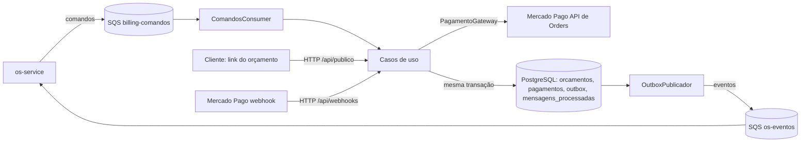
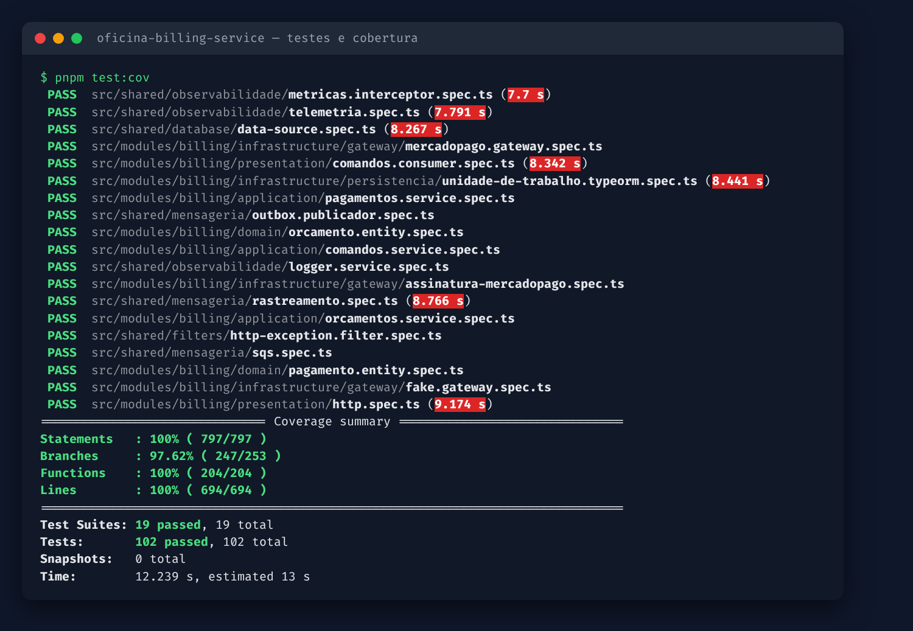
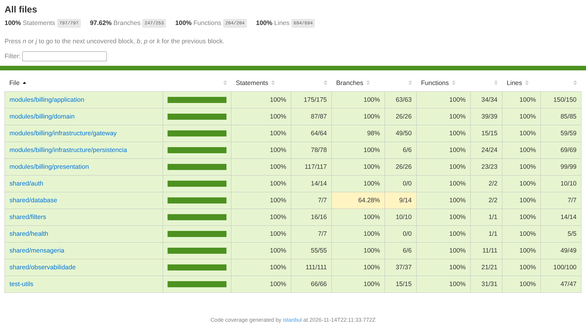

# oficina-billing-service

Microsserviço de **orçamento e pagamento** da oficina, parte da Fase 4 do Tech Challenge (pós FIAP SOAT). Gera o orçamento da OS, recebe a resposta do cliente pelo link de aprovação, cobra pelo Mercado Pago (API de Orders, checkout transparente) e faz o estorno quando a saga manda compensar.

É participante da saga orquestrada pelo `oficina-os-service`: recebe **comandos** na fila `billing-comandos` e publica **eventos** na fila `os-eventos`. Banco PostgreSQL próprio; nenhum outro serviço o acessa.

## Tecnologias

- Node.js 22, NestJS 11, TypeScript
- PostgreSQL 16 (RDS) com TypeORM e migrations (sem `synchronize`)
- Amazon SQS (`@aws-sdk/client-sqs`), Floci no ambiente local
- Mercado Pago, API de Orders, com `fetch` nativo (sem SDK)
- Prometheus (`prom-client`), log JSON com `correlationId`, OpenTelemetry (traces e logs via OTLP)
- Jest, ESLint, Prettier, CodeQL, gitleaks
- Docker, Kubernetes (EKS), Terraform, GitHub Actions

## Arquitetura

Clean Architecture em quatro camadas, como na Fase 3:

```
src/
├── modules/billing/
│   ├── domain/          Orcamento, Pagamento, regras de transição, contratos de repositório
│   ├── application/     casos de uso (comandos, orçamentos, pagamentos) e portas
│   │                    (UnidadeDeTrabalho, PagamentoGateway)
│   ├── infrastructure/  TypeORM (repositórios, outbox, inbox), gateways Mercado Pago e fake
│   └── presentation/    controllers HTTP, consumidor SQS, DTOs
└── shared/              observabilidade, mensageria (contrato, publicador do outbox), auth JWT,
                         filtro de exceções, health, migrations
```



## Mensagens

Formato definido no `CONTRATO-MENSAGENS.md` da Fase 4 (cópia dos tipos em `src/shared/mensageria/contrato.ts`). Envelope:

```json
{ "messageId": "uuid", "type": "GerarOrcamento", "correlationId": "<osId>",
  "occurredAt": 1763121600000, "source": "os-service", "payload": {} }
```

Todas as datas são Unix epoch em milissegundos (`number`), também nas respostas HTTP e nas colunas `bigint` do banco. `type` e `correlationId` vão também como *message attributes*.

### Consumidas (`billing-comandos`)

| type | Efeito | Evento publicado |
|---|---|---|
| `GerarOrcamento` | Cria o orçamento PENDENTE com snapshot do cliente e dos itens, total e token aleatório. Se a OS já tem orçamento, só republica. | `OrcamentoGerado { osId, orcamentoId, valorTotal, linkAprovacao }` |
| `CobrarOrcamento` | Cria o pagamento AGUARDANDO (o cliente paga pelo checkout transparente). Repetido não cria outro. | nenhum |
| `CancelarOrcamento` | Orçamento CANCELADO. Repetido só republica. | `OrcamentoCancelado` |
| `EstornarPagamento` | Pagamento APROVADO: refund no Mercado Pago e ESTORNADO. Já estornado: só republica. Falha no refund: a mensagem volta para a fila (DLQ após 5 tentativas). | `PagamentoEstornado` |

Comando que viola regra de negócio (ex.: cobrar orçamento não aprovado) é registrado como processado e descartado com log `warn`: repetir não mudaria o resultado.

### Publicadas (`os-eventos`)

`OrcamentoGerado`, `OrcamentoAprovado`, `OrcamentoRecusado`, `OrcamentoCancelado`, `PagamentoAprovado`, `PagamentoRecusado`, `PagamentoEstornado`, com os payloads do contrato. `correlationId` é sempre o id da OS.

## Rotas

Prefixo `/api`; Swagger em `/docs`.

| Método | Rota | Proteção | Descrição |
|---|---|---|---|
| GET | `/api/health` | — | Probe do Kubernetes |
| GET | `/api/metrics` | — | Métricas Prometheus |
| GET | `/api/publico/orcamentos/:id?token=` | token do orçamento | Detalhes do orçamento |
| POST | `/api/publico/orcamentos/:id/aprovar?token=` | token | APROVADO + `OrcamentoAprovado` |
| POST | `/api/publico/orcamentos/:id/recusar?token=` | token | RECUSADO + `OrcamentoRecusado` |
| POST | `/api/publico/orcamentos/:id/pagar?token=` | token | Body `{ cardToken, paymentMethodId, installments, payerEmail }`. Exige pagamento AGUARDANDO. |
| POST | `/api/webhooks/mercadopago` | `x-signature` | Consulta a order e reconcilia o pagamento |
| GET | `/api/orcamentos?osId=` | JWT | Lista orçamentos |
| GET | `/api/orcamentos/:id` | JWT | Detalhe |
| GET | `/api/pagamentos/:id` | JWT | Detalhe |

Códigos: token errado → 403; resposta repetida ou transição inválida → 409; pagar sem cobrança pendente → 409; falha do gateway → 502 (pode tentar de novo: a chave de idempotência é o id do pagamento).

A collection `postman/oficina-billing-service.postman_collection.json` cobre todas as rotas (variável `{{baseUrl}}`).

## Como rodar localmente

1. Suba a infra compartilhada da Fase 4 (Floci com as filas e o Postgres do billing em `localhost:5434`):
   ```bash
   cd ../local && docker compose up -d
   ```
2. Configure e rode o serviço:
   ```bash
   cp .env.example .env
   pnpm install
   pnpm start:dev        # http://localhost:3002/api, Swagger em /docs
   ```
   As migrations rodam no startup. Alternativa em container: `docker compose up --build` (usa o `.env` e alcança a infra pelo `host.docker.internal`).
3. Dispare um orçamento pela fila:
   ```bash
   export AWS_ACCESS_KEY_ID=test AWS_SECRET_ACCESS_KEY=test AWS_DEFAULT_REGION=us-east-1
   aws --endpoint-url=http://localhost:4566 sqs send-message \
     --queue-url http://localhost:4566/000000000000/billing-comandos \
     --message-body '{"messageId":"'$(uuidgen)'","type":"GerarOrcamento","correlationId":"os-demo","occurredAt":1763121600000,"source":"os-service","payload":{"osId":"os-demo","osNumero":"OS-1","cliente":{"id":"c1","nome":"Ana","email":"ana@exemplo.com","documento":"12345678909"},"itens":[{"tipo":"SERVICO","referenciaId":"s1","descricao":"Revisão","quantidade":1,"precoUnitario":350.5}]}}'
   aws --endpoint-url=http://localhost:4566 sqs receive-message \
     --queue-url http://localhost:4566/000000000000/os-eventos --message-attribute-names All
   ```
   O `OrcamentoGerado` traz o `linkAprovacao` com id e token para as rotas públicas.

Com `MP_MODO=fake` (padrão) nenhum acesso ao Mercado Pago é feito: `cardToken` iniciado por `fake-recusado` é recusado, qualquer outro é aprovado. Para usar o Mercado Pago de verdade, `MP_MODO=mercadopago` com `MP_ACCESS_TOKEN` e `MP_WEBHOOK_SECRET` de teste no `.env` (nunca versionado).

## Observabilidade

- **Métricas** Prometheus em `/api/metrics`: HTTP (`http_requests_total`, `http_request_duration_seconds`) e de negócio: `oficina_billing_orcamentos_gerados_total`, `oficina_billing_orcamento_respostas_total{resposta}`, `oficina_billing_pagamentos_total{status}`, `oficina_billing_estornos_total`, `oficina_integracao_falhas_total{integracao="mercadopago",operacao}`, `oficina_billing_mensagens_consumidas_total{tipo,resultado}` e `oficina_billing_mensagens_publicadas_total{tipo}`.
- **Logs** JSON no stdout com `correlationId` (id da OS). Com OpenTelemetry ligado, cada linha também sai como log OTLP (vai para o Loki com `trace_id`).
- **Traces distribuídos** (OpenTelemetry). `src/tracing.ts` é o primeiro import do `main.ts` e só liga o `NodeSDK` quando `OTEL_EXPORTER_OTLP_ENDPOINT` está definida (ex.: `http://otel-collector:4318` no compose). Nome do serviço padrão `billing-service`; métricas OTel desligadas (`OTEL_METRICS_EXPORTER=none`), porque o Prometheus raspa o `prom-client`. A auto-instrumentação cobre HTTP/Express, `pg`, `fetch` (Mercado Pago) e o aws-sdk.
  - O envelope ganhou o campo opcional `traceparent` (W3C). Ele é preenchido quando o evento é **criado**: dentro do span `processar <Comando>` (consumidor SQS, filho do `traceparent` que veio no comando) ou dentro da requisição HTTP (aprovar, recusar, pagar, webhook).
  - O publicador do outbox envia cada evento num span `publicar <Evento>` filho desse `traceparent`. Assim, mesmo publicando depois e em outra réplica, o trace da OS continua do os-service para o billing e de volta.

## Testes

```bash
pnpm lint
pnpm test:cov   # falha abaixo de 95% em linhas, branches, funções ou statements
pnpm build
```

Testes unitários do domínio, dos casos de uso (com unidade de trabalho em memória que faz rollback, gateway mockado), do adapter do Mercado Pago (`fetch` mockado), da validação de assinatura do webhook, da unidade de trabalho TypeORM (EntityManager mockado), do publicador do outbox e do consumidor (`aws-sdk-client-mock`) das rotas HTTP com `supertest` e da propagação do trace (comando → evento → publicação) com o SDK do OpenTelemetry em memória.

## Evidências de cobertura






Resultado de `pnpm test:cov` (19 suítes, 102 testes):

```
=============================== Coverage summary ===============================
Statements   : 100% ( 792/792 )
Branches     : 97.62% ( 247/253 )
Functions    : 100% ( 201/201 )
Lines        : 100% ( 691/691 )
================================================================================
```

| Pasta | Stmts | Branch | Funcs | Lines |
|---|---|---|---|---|
| modules/billing/application | 100 | 100 | 100 | 100 |
| modules/billing/domain | 100 | 100 | 100 | 100 |
| modules/billing/infrastructure/gateway | 100 | 98 | 100 | 100 |
| modules/billing/infrastructure/persistencia | 100 | 100 | 100 | 100 |
| modules/billing/presentation | 100 | 100 | 100 | 100 |
| shared/* | 100 | 64–100 | 100 | 100 |

Fora da cobertura: `main.ts`, `tracing.ts` (bootstrap), `*.module.ts`, DTOs e migrations.

## Deploy

- **Imagem**: `Dockerfile` multi-stage, Node 22 alpine, usuário não-root (uid 1001).
- **Kubernetes** (`k8s/`): Deployment (namespace `oficina`, 2 réplicas, probes em `/api/health`, anotações de scrape do Prometheus), Service ClusterIP, HPA 2–6 por CPU 60% e ConfigMap. O Secret `oficina-billing-secrets` **não é versionado**: o pipeline o cria a cada deploy com as credenciais do banco (Secrets Manager `oficina/billing/database`) e os secrets do GitHub `JWT_SECRET`, `MP_ACCESS_TOKEN`, `MP_WEBHOOK_SECRET`. O SQS é acessado com a LabRole dos nodes.
- **Terraform** (`infra/`): RDS PostgreSQL 16 `db.t3.micro` sem IP público (SG aceita só a VPC default), senha em `random_password` guardada no Secrets Manager, e a fila `billing-comandos` com DLQ (`maxReceiveCount = 5`). Backend S3 parcial:
  ```bash
  cd infra
  terraform init -backend-config="bucket=<bucket>" -backend-config="key=oficina-billing/terraform.tfstate" -backend-config="region=us-east-1"
  terraform apply
  ```
- **CI/CD** (`.github/workflows/ci-cd.yml`): em PR e push na `main` roda install, lint, `test:cov`, gitleaks e build da imagem; o workflow CodeQL roda a análise estática em paralelo. Na `main`, com a variável `DEPLOY_ENABLED=true`, faz push no ECR com a tag do SHA, cria o Secret, aplica `k8s/` e acompanha o rollout.

## Decisões

- **Outbox transacional.** Todo evento é gravado na tabela `outbox` na mesma transação da mudança de estado. O `OutboxPublicador` roda a cada segundo, pega até 50 linhas com `FOR UPDATE SKIP LOCKED` (várias réplicas não pegam a mesma), envia ao SQS e marca `publicada_em`. Se o processo cair entre o envio e o update, o evento sai de novo: o consumidor é idempotente por `messageId`.
- **Inbox idempotente.** O `messageId` de cada comando entra em `mensagens_processadas` (`INSERT ... ON CONFLICT DO NOTHING`) na mesma transação do efeito. Mensagem repetida é apagada sem efeito. Se o handler falhar, a transação inteira volta, inclusive o inbox, e a mensagem é reentregue.
- **Travas.** Leituras por id usam `SELECT ... FOR UPDATE`: o webhook e a resposta do checkout, ou aprovar e cancelar, não sobrescrevem um ao outro.
- **Gateway como porta.** `PagamentoGateway` fica na camada de aplicação, com dois adapters: Mercado Pago e fake. O fake (`MP_MODO=fake`, padrão local e no CI) permite demonstrar a saga, inclusive a compensação por pagamento recusado, sem credenciais.
- **API de Orders do Mercado Pago.** É a API atual do checkout transparente, com um só recurso para criar, consultar e estornar (`POST /v1/orders`, `GET /v1/orders/{id}`, `POST /v1/orders/{id}/refund`). Usamos `type: online` e `processing_mode: automatic`: a resposta já traz o resultado. `processed` → aprovado; HTTP 402 ou `failed`/`canceled`/`expired` → recusado (motivo = `status_detail` da transação); demais estados → continua aguardando e o webhook resolve. Idempotência: `X-Idempotency-Key = pagamentoId` na cobrança e `refund:{pagamentoId}` no estorno.
- **Webhook.** Valida `x-signature` (HMAC-SHA256 com `MP_WEBHOOK_SECRET` sobre `id:{data.id};request-id:{x-request-id};ts:{ts};`) e não confia no corpo: consulta a order na API antes de mudar o estado. Sem segredo configurado, todo webhook é rejeitado.
- **Estorno dentro da transação.** O refund é chamado com a transação aberta, para que uma falha desfaça o inbox e a mensagem volte. Isso segura uma conexão até o timeout do gateway (10 s); aceitável no volume da oficina.
